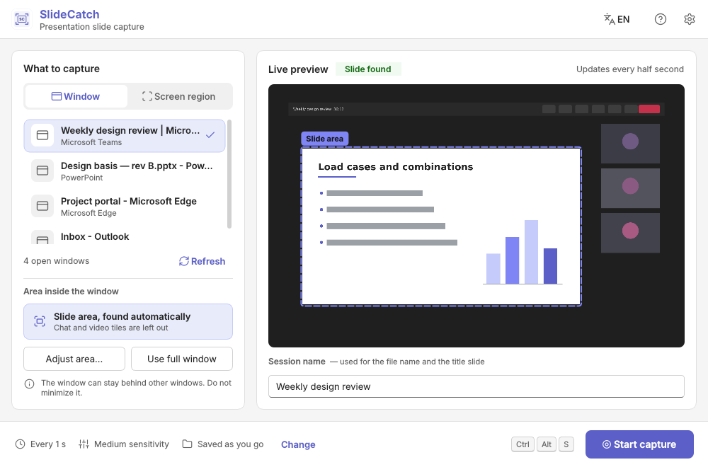
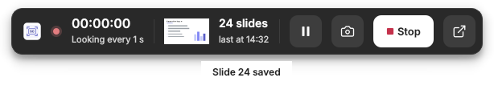
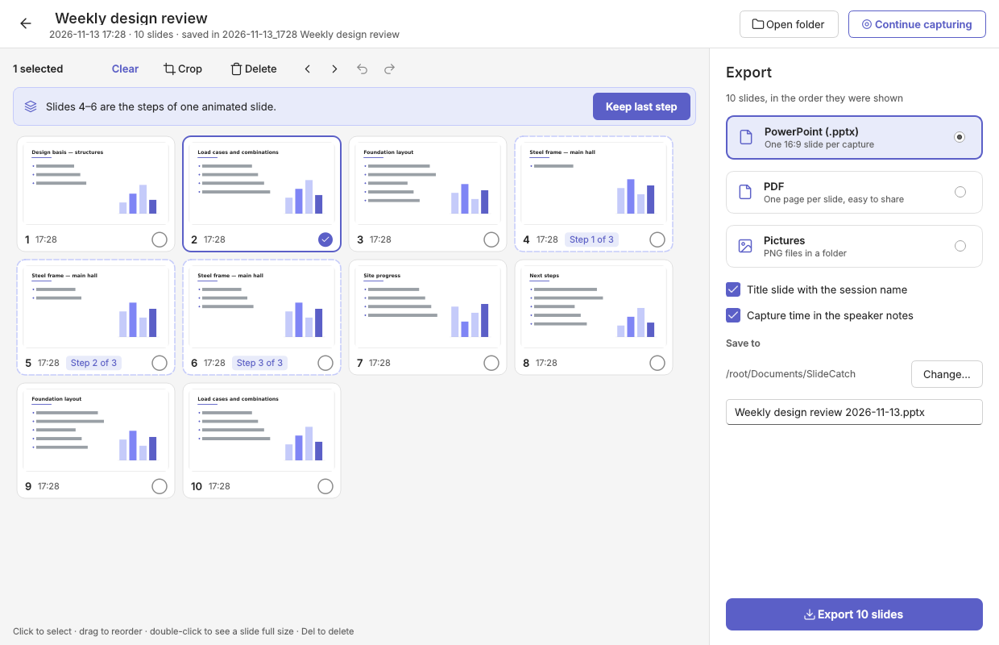
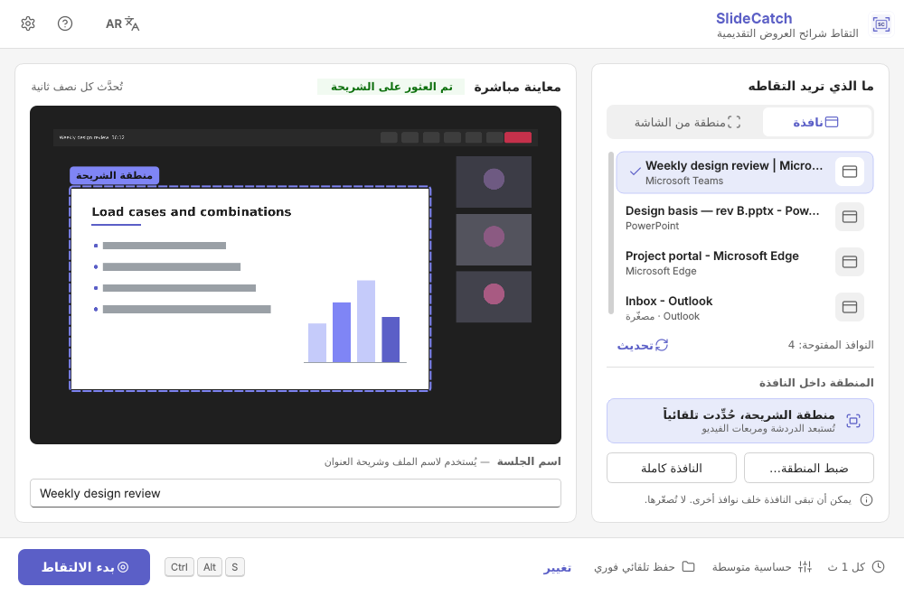
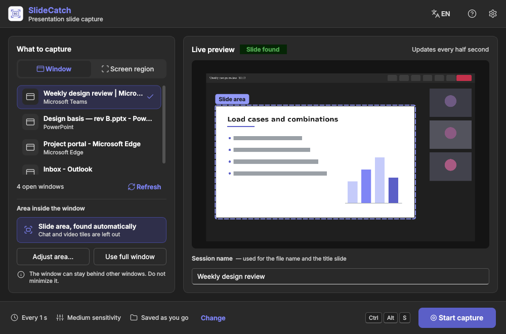

# SlideCatch

**Catch every slide of a presentation shared in Microsoft Teams — automatically — and get it back as a PowerPoint, a PDF or pictures.**

Version 0.1.0 · Windows 10 (1903+) and 11 · portable, no installation, no administrator rights · English, Français, العربية



> **En bref (FR)** — SlideCatch observe la fenêtre de la réunion Teams et garde une image de chaque nouvelle diapositive, même si la fenêtre est derrière d'autres fenêtres. À la fin, vous vérifiez les diapositives (supprimer, réordonner, rogner, fusionner les animations) puis vous exportez en PowerPoint, PDF ou images. Rien ne quitte votre ordinateur.

---

## Using SlideCatch

1. **Download** `SlideCatch-0.1.0-portable.zip` (Releases page of this repository), unzip it anywhere — Desktop, Documents, a USB stick — and run **`SlideCatch.exe`**.
2. Accept the terms of use (first start only).
3. Under **What to capture**, pick the meeting window (usually already selected). The live preview outlines the slide with a dashed line: SlideCatch finds the shared slide inside the Teams window by itself and leaves out the chat, the toolbar and the video tiles.
4. Type a session name if you like, then click **Start capture**. The main window steps aside and a small bar shows the time and the number of slides.
5. At the end, click **Stop**. Check the slides, then **Export** to PowerPoint, PDF or a folder of pictures.

| Shortcut (works while Teams has the focus) | |
|---|---|
| **Ctrl+Alt+S** | start / stop |
| **Ctrl+Alt+C** | capture this slide now |
| **Ctrl+Alt+P** | pause / resume |

The full guide is inside the app (**?** button), in the three languages.

<p>

</p>



### What it does well

- **Captures a covered window.** The Teams window can stay behind your other work (it must not be minimized). Windows Graphics Capture is used first, then PrintWindow, then a plain screen copy if a computer refuses the others.
- **Keeps slides, not noise.** A slide is saved once it is steady (end of transition, share sharp). The mouse pointer and webcams are ignored; going back to an earlier slide adds nothing; a sharper picture arriving just after the save replaces the blurry one.
- **Animations.** Slides that appear bullet by bullet are recognised as steps of one slide; keep only the last step with one click (or automatically).
- **Nothing is lost.** Every slide is written to disk the moment it is caught. After a crash or a power cut, SlideCatch offers to restore the session.
- **Review before export.** Delete, reorder (drag and drop), crop, merge animation steps, undo / redo — the captured pictures are never altered.
- **Exports.** PowerPoint (one picture per slide, optional title slide, capture time in the speaker notes), PDF, or numbered PNG files.
- **Light and dark themes** in the Microsoft Teams colours; **English, French, Spanish, German and Arabic** (Arabic with a fully mirrored interface).
- **Private by design.** Works offline, no account, nothing from you is uploaded. SlideCatch connects to the internet only to check for and download app updates.

### Good to know

- Ask the presenter before capturing, as you would before recording a meeting.
- A capture of a *screen region* needs that region to stay visible; the *window* mode does not.
- Settings are kept in `%APPDATA%\SlideCatch`, sessions in `Documents\SlideCatch\Sessions`. For a USB stick, put an empty file named `SlideCatch.portable` next to `SlideCatch.exe`: everything then stays in that folder.

<p>


</p>

---

## For developers

Python 3.10+ and Qt (PySide6). See **[docs/DEVELOPMENT.md](docs/DEVELOPMENT.md)** for the full walk-through (VS Code set-up, how each part works, adding a translation, releasing a new version).

```bat
run_from_source.bat              :: first run prepares .venv, then starts the app
scripts\build_windows.bat        :: tests + build + self-test + zip  ->  dist\
```

```text
slidecatch/
  core/        capture (Windows Graphics Capture, PrintWindow, screen), slide detection,
               slide-area finder, crash-safe sessions, PowerPoint writer - no Qt here
  ui/          the PySide6 interface (main window, mini bar, review, settings, dialogs)
  locales/     interface texts (French, Spanish, German, Arabic)
  resources/   user guide and terms in each language, icon
tests/         pytest suite (generated pictures; Windows capture tests run on Windows only)
scripts/       build script, screenshot renderer, text list for translators
SlideCatch.spec  PyInstaller recipe (trimmed Qt: small download)
```

Every push runs the tests on Linux and Windows, builds the portable folder, runs the built program's self-test and reports the download size (**Actions** tab). Raising the version in `slidecatch/__init__.py` publishes a new release with the zip automatically.

## Licence

© 2026 Abdelhalim EL HAOUARI. All rights reserved — see [LICENSE.txt](LICENSE.txt).
Built with Python and Qt for Python (PySide6, LGPL-3.0); see [THIRD_PARTY_NOTICES.md](THIRD_PARTY_NOTICES.md).
